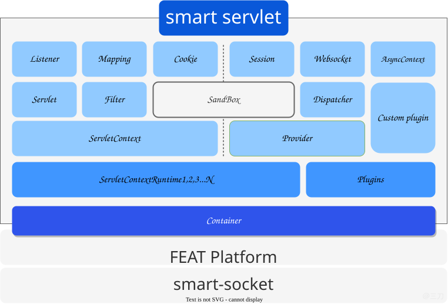

# smart-servlet

轻量、高性能、面向未来的 Servlet 容器，基于 Jakarta Servlet 6.0，适用于 Java 17+ 环境。

---

## 开源协议

**smart-servlet 采用 [Apache License 2.0](./LICENSE) 开源协议，企业可免费用于生产与商业场景，无需采购使用授权。**

- 允许商用、修改、再分发、嵌入闭源产品、作为托管服务对外提供
- 无并发数、部署规模、功能或试用时长的限制，免费用户与企业服务订阅客户使用同一份代码
- 再分发时需保留版权声明与 NOTICE 文件，遵守 Apache-2.0 的专利授权与商标条款
- 商标、官方认证与兼容性标识不属于 Apache-2.0 授权范围，使用前需获得书面许可

---

## 温馨提示

1. smart-servlet **未进入信创目录**，但核心技术 100% 自主研发，企业可进行代码审计和安全评估；订阅企业服务的客户可获得合规材料配合。
2. 软件按"现状（AS IS）"提供，生产环境建议先完成充分测试与风险评估。
3. **企业付费购买的是答疑咨询与需求支持，不是使用许可**：公开 Issue 仅提供开源生态支持（社区尽力而为、无 SLA 承诺）；订阅客户享有 1 对 1 专属顾问答疑、功能需求评估与优先排期、生产故障协助与指定版本长期维护。

---

## 企业实践

smart-servlet 已与金融、制造、政企、工业互联网等多个行业开展技术交流与 POC 验证，累计 **30+ 次真实业务场景验证**，保障项目在生产环境中的可靠性。

---

## 企业服务订阅

社区版功能完整且免费。付费服务面向在生产环境深度使用、希望获得专业答疑与需求支持的团队，按年度订阅，交付内容如下：

| 能力 | 社区版（免费） | 企业服务订阅（付费） |
| :--- | :---: | :---: |
| 使用授权 | Apache-2.0，商用免费 | 相同，无需额外授权 |
| 功能、性能、并发与部署规模 | 完全一致，无限制 | 完全一致 |
| 问题响应 | 公开 Issue 开源生态支持，尽力而为、无 SLA | 1 对 1 答疑咨询（专属对接人／专属群／服务工单），及时响应、跟进到底 |
| 需求支持 | 公开建议渠道，按社区节奏排期 | 功能需求评估、优先排期与定制化方案 |
| 生产故障处置 | 自行处理 | 优先处置、远程/现场兜底支持 |
| 版本维护 | 跟随主干版本 | 指定版本长期维护（LTS）、安全补丁、EOL 提前通知 |
| 大版本升级 | 自助适配 | JDK / Spring Boot / Jakarta Servlet 升级适配指导 |
| 合规与信创材料 | 文档自助 | 代码审计说明、SBOM、兼容性与国产化适配证明、供应链安全问卷及等保测评配合 |
| 实施与调优 | 自助 | 迁移实施、上线前架构评审、压测与性能调优、培训（按人天） |
| 生态权益 | 无 | 服务客户公示、兼容性认证、生态合作（商标使用需单独授权） |

**计费方式**：按部署规模与支持等级年度订阅；实施、定制开发与驻场按人天计价。具体报价与服务范围欢迎通过商务渠道咨询确认。

订阅服务不改变开源协议，也不会限制未订阅用户使用任何功能。

---

## 支持渠道与服务咨询

**公开 Issue 仅提供开源生态支持**：面向所有免费用户的 Bug 反馈、使用咨询与改进建议，由社区尽力而为，不承诺响应时效，不提供 SLA 与故障兜底。请勿在公开 Issue 提交生产故障、密钥口令、内网拓扑或业务数据。

- [开源生态支持（问题反馈）](https://gitee.com/smartboot/smart-servlet/issues/new?template=opensource_bug.yml)

**企业服务咨询与订阅**：咨询服务内容、报价、合规材料或申请年度服务订阅，请通过 1 对 1 渠道联系商务，不在公开 Issue 提交。

- 邮箱：`zhengjunweimail@163.com`
- 服务说明与联系方式：[服务客户与生态伙伴](https://smartboot.tech/smart-servlet/users/)

**订阅客户**：请使用专属的 **1 对 1 服务通道**（专属对接人／专属沟通群／服务工单），公开 Issue 不受理订阅客户的报障与 SLA 诉求。

> 建议先完成产品试用并确认满足业务需求，再评估是否需要订阅服务。

---

## 产品特色

- **自主可控**：核心技术完全自主研发，便于代码审计与长期维护
- **性能优越**：搭载 smart-socket 微内核，处理高并发能力出色
- **规范兼容**：遵循 Jakarta Servlet 6.0，兼容主流 Servlet 应用
- **运行灵活**：支持 War 包、Spring Boot、Maven Plugin 等多种运行方式
- **服务可选**：需要专业答疑与需求支持的团队可选择 1 对 1 企业服务与长期维护

---

## 目标用户

1. 有国产化替代、自主可控需求的企业用户
2. 对服务并发能力与资源利用率要求高的企业用户
3. 需要长期技术支持、答疑咨询与合规材料保障的企业用户

---

## 项目推荐

- [smart-socket](https://gitee.com/smartboot/smart-socket) — 极简高性能 AIO 通信框架，适用于 IM、RPC、IoT
- [feat](https://gitee.com/smartboot/feat) — 基于 smart-socket 的轻量级 HTTP 服务器
- [smart-mqtt](https://gitee.com/smartboot/smart-mqtt) — 基于 smart-socket 的 MQTT 3.1.1/5.0 Broker & Client 服务
